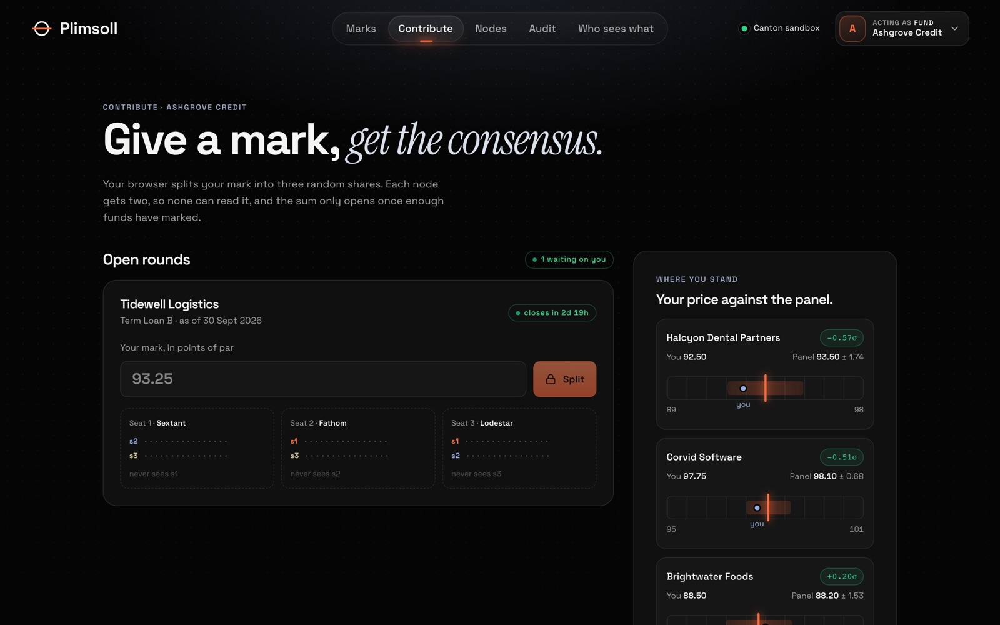
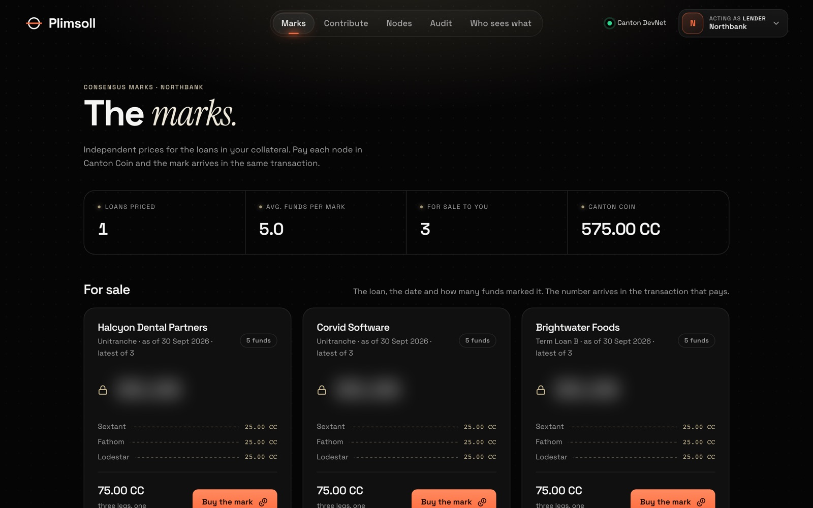
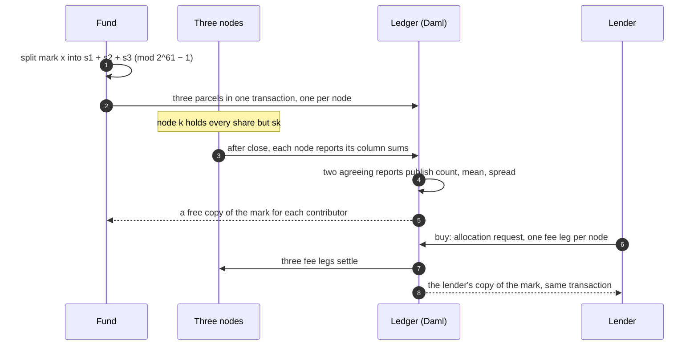
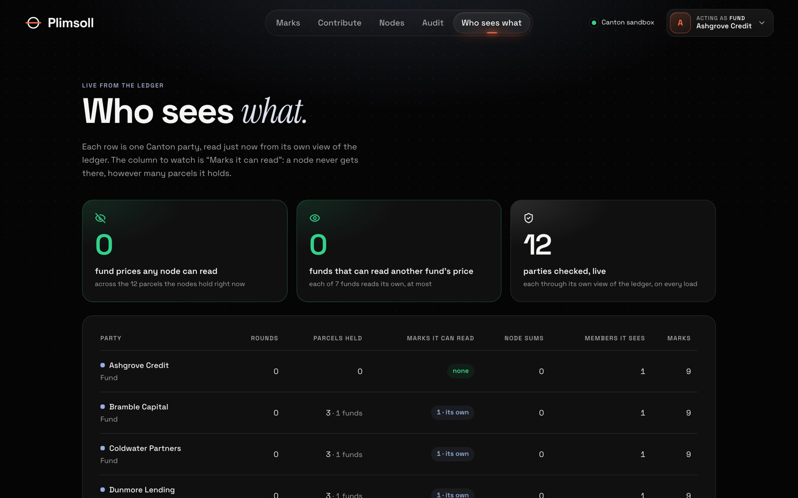

# Plimsoll

**Consensus marks for private credit, on Canton.**

Funds that hold the same private loan each send a price for it. No one sees any
single price: not the other funds, and not the three nodes that run the panel.
Every contributor gets back the average and the spread, and lenders can buy the
same mark in Canton Coin, delivered in the transaction that pays for it.

**[Live demo](https://plimsoll-demo.up.railway.app)** ·
**[Run on the Canton DevNet, in Canton Coin](docs/devnet.md)** ·
HackCanton Season 3 · Data, Analytics & Ecosystem Dashboards


## The problem

Private loans rarely trade, so every fund prices its own holdings. Two funds can
carry the same loan at different marks, and the banks lending against those
portfolios either accept the fund's number or pay for a valuation of their own.
Funds would compare notes if it didn't mean showing their book to competitors.

A shared database or a public chain can't help: whoever runs it, or anyone
reading it, would see every fund's price. A trusted third party can, but it then
holds the most sensitive number each fund has.

## What Plimsoll does

Plimsoll lets funds compare without showing anything. Canton keeps each
contract private to its parties, and secret sharing keeps each price private
even from the panel's own operators.

- **Private by construction.** Each mark is split into three shares in the
  fund's browser. Each node holds two of the three, so no node can rebuild a
  price, and every parcel is visible only to the fund and one node.
- **Computed on the ledger.** The nodes' column sums are computed in Daml from
  the parcels themselves, so a node can't report numbers it didn't receive, or
  report twice. Any two agreeing reports publish the mark.
- **Give to get.** Every fund that marked a round gets the consensus back for
  free. The mark names no fund.
- **Paid for atomically.** A lender buys a mark through a CIP-56 allocation
  request with one fee leg to each node. All three legs and the lender's copy
  of the mark settle in one transaction, or nothing does.
- **Used as a collateral price.** A lender values each loan in a fund's
  borrowing base at the lower of the fund's own mark and the consensus less one
  standard deviation.

<table>
  <tr>
    <td></td>
    <td></td>
  </tr>
  <tr>
    <td align="center">A fund's mark, split into three shares in its browser</td>
    <td align="center">A lender's view on DevNet, paying in Canton Coin</td>
  </tr>
</table>

## How it works



1. **Split.** A fund's mark `x` (hundredths of a point) is split in its browser
   into three shares with `s1 + s2 + s3 ≡ x (mod 2^61 − 1)`, and the same again
   for `x²`. Seat *k* receives every share but `sk`, so each node holds two
   pieces of each mark and none holds all three.
2. **Send.** Every admitted fund holds three invitations, one signed by each
   node. Exercising all three in one transaction creates three parcels, each
   signed by the fund and one node, so each node sees only its own.
3. **Report.** After the round closes, each node collects its parcels through
   its own seat. Column sums are computed in Daml from the parcels themselves,
   which are consumed, so no node can report numbers it didn't receive or
   report twice.
4. **Publish.** Any two reports that cover the same funds and agree on their
   shared column publish the mark: count, mean, standard deviation. The model
   checks the sums are reachable by real prices (0–200) and consistent
   (Cauchy–Schwarz). Each contributor gets a free copy; its auditor observes it.
5. **Read.** A reader sees a listing (loan, date, number of funds, not the
   price). Buying opens a CIP-56 `AllocationRequest` with one fee leg to each
   node; the executor settles all three legs and creates the reader's copy of
   the mark in one transaction. If any leg falls short, nothing settles.



## Try it

The [live demo](https://plimsoll-demo.up.railway.app) runs a Canton sandbox
with the demo panel already seeded: three nodes, six funds and one applicant,
a lender and an auditor, nine published marks for three loans over three
quarters, and one live round. Pick who you act as from the menu at the top
right. Everyone shares the one ledger, so you may see what other visitors did.

1. **As Ashgrove Credit (fund)**, open *Contribute*, type a mark for Tidewell
   Logistics and split it. Each node's parcel shows the two shares it gets.
2. Open **Who sees what**: every party's row is read from its own view of the
   ledger. No node can read a single fund's price.
3. **As Sextant (node)**, open *Nodes* and open a one-minute round for a new
   loan. Contribute to it as five funds, wait for it to close, then have each
   node report its column sums and publish.
4. **As Northbank (lender)**, open *Marks* and buy a mark: three fee legs and
   the mark arrive in one transaction. Use it in the collateral calculator.
5. **As Ledgerwise Audit**, open *Audit*: the auditor recovers what Ashgrove
   submitted.
6. **As each node**, approve or reject Greystone's application to join. It
   takes all three.

The hosted demo pays in the CIP-56 reference test token, labelled *test CC*.
The same app on the HackCanton DevNet pays in real Canton Coin; see below.

## On the Canton DevNet, in Canton Coin

Plimsoll runs on the HackCanton DevNet node with its parties and DAR uploaded
through the node's Console. `make devnet-smoke` passed all 22 checks there on
8 October 2026: a round opened, five funds contributed, every privacy check
held, all three nodes reported, the mark was published, and the reader bought
it in Canton Coin.

That purchase is one transaction (update id
`12200cbb68478d6df02f74153056fecda437d3414cd5825142a143220e1a69775fee`) that
exercises Plimsoll's `ReadRequest_Fulfil`. Inside it, Canton Coin's own
`Allocation_ExecuteTransfer` runs three times, one 25 CC fee leg to each node,
and the reader's `MarkCopy` is created. The app gets Canton Coin's allocation
factory and choice contexts from the validator's scan proxy, and pins every
submission to Plimsoll's package ids on the shared node. Details in
[docs/devnet.md](docs/devnet.md).

## What is enforced, and where

Every claim above is a Daml Script test in `daml/plimsoll-tests` (26 tests):

| Claim | Test |
|---|---|
| No node holds all three shares of any mark | `Privacy: test_no_node_holds_all_three_shares_of_any_mark` |
| A fund sees only its own contracts | `Privacy: test_a_fund_sees_only_its_own_contracts` |
| The published mark names no fund | `Privacy: test_the_mark_names_no_fund` |
| A fund's auditor can recover what its client submitted | `Privacy: test_the_funds_auditor_can_recover_what_it_submitted` |
| A reader sees listings, not marks, until it pays | `Privacy: test_a_reader_sees_listings_not_marks_until_it_pays` |
| Mean and spread are exact | `Round: test_consensus_is_the_mean_and_spread_of_the_marks` |
| Any two reports publish the same mark; one cannot | `Round: test_any_two_reports_publish_the_same_mark`, `test_one_report_cannot_publish` |
| Nothing is revealed below the panel minimum | `Round: test_nothing_is_revealed_below_the_minimum` |
| Inconsistent shares stop the round | `Round: test_inconsistent_shares_stop_the_round` |
| A parcel counts once | `Round: test_a_parcel_counts_once` |
| Impossible sums are refused | `Round: test_sums_no_set_of_real_marks_could_produce_are_refused` |
| Panel and membership need all three nodes | `Panel: test_panel_forms_only_when_all_three_nodes_sign`, `test_fund_joins_only_when_all_three_nodes_approve` |
| A panel needs at least four contributors | `Panel: test_panel_needs_at_least_four_contributors` |
| The reader pays every node and gets the mark atomically | `Access: test_reader_pays_every_node_and_gets_the_mark_atomically` |
| An underfunded leg delivers nothing | `Access: test_an_underfunded_leg_delivers_nothing` |
| The read request is a standard CIP-56 allocation request | `Access: test_the_request_is_a_standard_allocation_request` |

The app's writes are checked against a running ledger too: `make smoke` drives
a round through every action the app offers and checks the mark, the fees and
who saw what (22 checks), on the sandbox or, with `make devnet-smoke`, on
DevNet.

## Limits

- **No range proof on a secret price.** A fund can submit a wrong price, as in
  any survey. Sums no real set of prices could produce are refused, and a
  single outlier shows up in the spread.
- **Two colluding nodes can reconstruct marks.** That is the 2-of-3 threshold;
  seats should go to independent firms.
- **Publishing needs all three nodes' participants online**, since they all
  sign the round. "Any two reports" is about the data, not availability.
- **The demo app submits for every persona** so one person can play all of
  them, and every party sits on one participant. In production each fund splits
  its mark in its own client and submits from its own participant.
- **The hosted demo and the local sandbox pay in the CIP-56 reference test
  token.** Canton Coin settlement runs on DevNet, through the same allocation
  interfaces.

## Run it

Needs [dpm](https://docs.digitalasset.com) with SDK 3.5.12, Java 17+, and
Node 22 with corepack.

```sh
make build      # model, tests, demo package
make test       # the 26 tests above
make sandbox    # local Canton ledger, JSON Ledger API on :7575 (leave running)
make seed       # parties, panel, six funds and one applicant, three quarters of marks for three loans, one live round
make smoke      # every write the app makes, checked against the ledger (22 checks)
make web        # the app on http://localhost:3000
```

`make seed` can be rerun at any time; party ids are tagged per run.

### On the HackCanton DevNet

Create the twelve parties and upload the model DAR in the node's Console, then:

```sh
make devnet-login   # hackathon email and password; tokens stay in .plimsoll/
make devnet-seed    # the same demo on those parties; the reader's CC from the faucet
make devnet-web     # the app against DevNet
make devnet-smoke   # a round through every app action, and a purchase in CC
```

See [docs/devnet.md](docs/devnet.md).

### In a container

[deploy/Dockerfile](deploy/Dockerfile) builds the hosted demo: a Canton
sandbox with Plimsoll, seeded on start, and the web app in front of it. Canton,
Daml Script and the demo DAR (from this repository's
[v0.1.0 release](https://github.com/martinvibes/plimsoll/releases/tag/v0.1.0))
are each pinned by digest.

```sh
docker build -f deploy/Dockerfile -t plimsoll-demo .
docker run -p 3000:3000 plimsoll-demo
```

## Layout

```
daml/plimsoll          the model: panel, membership, rounds, seats, marks, access
daml/plimsoll-tests    Daml Script tests
daml/plimsoll-demo     the demo seed, for the sandbox and DevNet
daml/dars              vendored Splice token-standard packages (see its README)
web                    Next.js app on the JSON Ledger API v2
scripts                DevNet sign-in, seed and reset
deploy                 the hosted demo's container
docs                   running on DevNet
```

## License

Apache-2.0. See [LICENSE](LICENSE) and [NOTICE](NOTICE).
